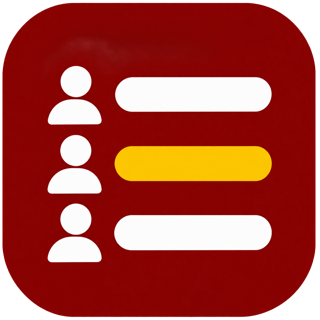
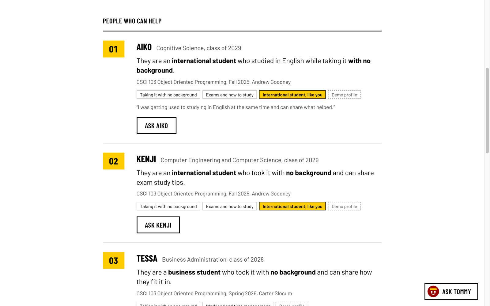
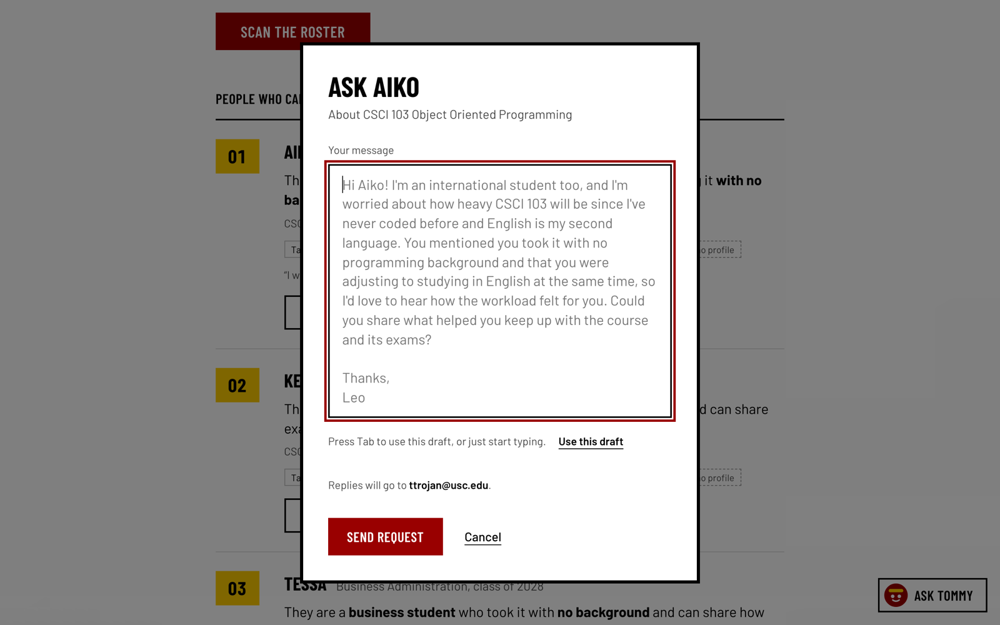
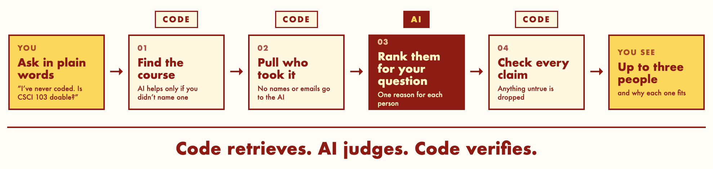

<p align="center">
  
</p>

<h1 align="center">Tommy's Roster</h1>

<p align="center">
  Ask a question about a USC course in your own words.<br>
  Get matched with up to three students who took it, and a reason for each one.
</p>

<p align="center">
  <a href="https://tommys-roster.vercel.app"><b>Try it live →</b></a>
  &nbsp;·&nbsp; Built in 24 hours at the AI@USC Hackathon 2026
</p>

<p align="center">
  
</p>

## What you can do

- **Ask.** "I've never coded. Is CSCI 103 doable?" The AI picks who can answer that, and says why.
- **Reach out.** Press Ask and a first message is drafted for that one person. Press Tab to accept it, or write your own.
- **Join.** Took a class? Add yourself so the next student can ask you.
- **Stay in control.** See, edit, download or delete everything you gave the site, from the Account page.

<p align="center">
  
</p>

## How a match happens



1. Code reads the course from your question and looks it up in USC's catalog. If you named it in plain words ("organic chemistry"), a small AI call works out which course you mean.
2. Code pulls the students who took that course. No names or emails go to the AI.
3. The AI ranks them for your question and your profile, and writes one sentence on why each fits.
4. Code checks every person, course, year and professor in the answer against the roster. Anything untrue is dropped.

If the AI is down, you still get the most recent people for the course, without reasons.

We wrote 14 questions where the roster has one clear best person. With the AI that
person came first 14 times; sorting by most recent semester, 4 times. A match takes
about two seconds. It is a small check on sample data, not a benchmark.

## Built with

Next.js 16, React 19, TypeScript, Tailwind · Claude API (Haiku 5.5) with structured
outputs and tool use · Google sign-in limited to usc.edu accounts · Resend for email ·
Vercel.

Courses and instructors (1,595 courses, Fall 2024 to Fall 2026) come from USC's public
Schedule of Classes. The 60 students on the roster are invented for the demo; the
courses, semesters and professors attached to them are real and checked by a script.

## Run it

```bash
npm install
cp .env.example .env.local   # add ANTHROPIC_API_KEY; the rest is optional
npm run dev                  # http://localhost:3000
```

`.env.example` explains every setting, including how to turn on USC Google sign-in
and email. `npm run fetch-catalog` refreshes the course data when a new semester starts.

## Privacy

- Your profile and the messages you sent stay in your browser. There is no account database.
- The AI never gets a name or an email, and what you type is not stored or logged.
- Emails are kept only where they are needed to pass a request on, and no page or API shows anyone else's.
- "Delete my account and all data" removes what the server has and clears the browser.

The statement users accept is in `lib/privacy.ts`, and every line of it matches the code.

## What is not done yet

- No database: people who join and requests sent are held in memory, so they are lost when the server restarts.
- The roster is sample data. Match quality with real students depends on what they write.
- Guest access does not verify the address typed. It is there for people without a USC account.
- Email reaches any inbox only once a sending domain is verified.

## Where things are

| Part | Folder | What is in it |
| --- | --- | --- |
| Frontend | `app/` (pages), `components/` | The screens: sign-in, onboarding, the question box, the ask window, account |
| Backend | `app/api/`, `lib/` | The API routes, matching, drafts, the helper, sign-in, email, privacy text |
| Data | `data/`, `scripts/` | USC course data, the sample roster, and the scripts that build them |

Frontend and backend live in one Next.js app, so they deploy together.

`SPEC.md` has the full contract for the API and the pages.

## Team

Kushal Bhanot · Angela Chen · Alassane Fofana · Leo Wan
